# atrium — brand guide

Name and mark of the iSAQB online platform. English summary of the original
German brief, [`atrium-logo-brief.md`](atrium-logo-brief.md) (as of 2026-10-12),
which stays authoritative. The original source is archived under
`raw/ingested/atrium-brand/`.

> These are *meta* requirements — on the project's identity and presentation,
> not on the atrium system itself — so they live in `docs/`, not in `wiki/`.

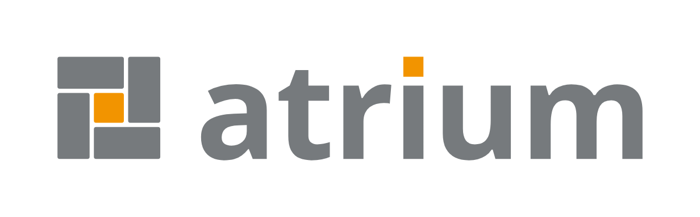

## Idea

An atrium is the open courtyard at the centre of a building, with rooms around
it. The mark is its floor plan seen from above.

- **The orange courtyard is iSAQB** — the association, curricula, certification.
- **The four rooms are the access points** through which iSAQB is reached online.
- The rooms turn like a pinwheel around the courtyard: no access point is the
  main entrance, and new rooms can be added.

| Room | Access point | For whom |
| --- | --- | --- |
| 1, top | Public website | Interested parties, members, companies |
| 2, right | Provider app | Training providers, with login and review |
| 3, bottom | Contact and newsletter | Questions and news |
| 4, left | Data repository and feeds | Machines: dates, providers, modules as JSON and ICS |

The wordmark echoes this: the dot on the "i" of *atrium* is an orange square —
the courtyard, and so iSAQB.

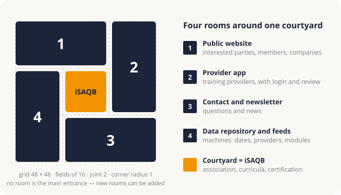

## Mark

| Navy | Grey | Navy, dark | Grey, dark | On orange |
| --- | --- | --- | --- | --- |
|  |  | 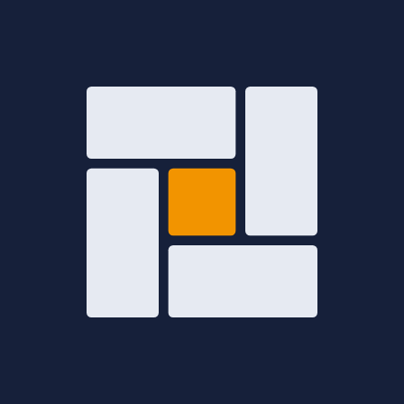 | 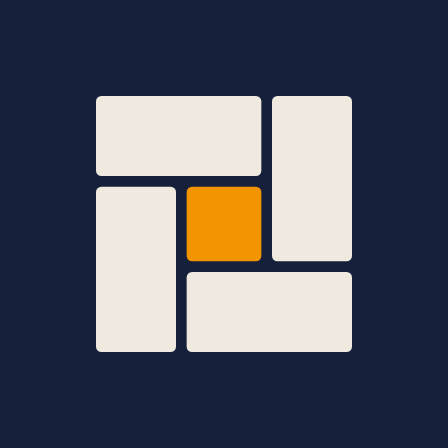 |  |

**Construction.** 48 × 48 unit grid, three fields of 16. Each room is inset by
one unit, giving a uniform 2-unit joint. Corner radius 1.

| Element | x, y | Width × height |
| --- | --- | --- |
| Room 1 (top) | 0, 0 | 31 × 15 |
| Room 2 (right) | 33, 0 | 15 × 31 |
| Room 3 (bottom) | 17, 33 | 31 × 15 |
| Room 4 (left) | 0, 17 | 15 × 31 |
| Courtyard | 17, 17 | 14 × 14 |

## Lockups

Main lockup: mark and wordmark side by side; the mark spans from the baseline to
the top of the i-dot.

| | Light | Dark |
| --- | --- | --- |
| Grey |  | 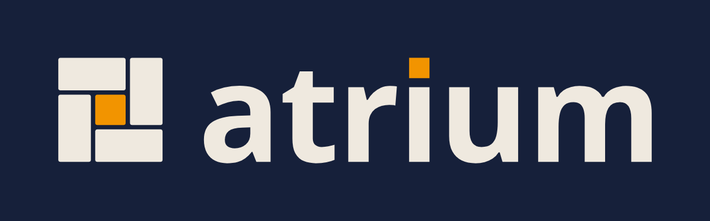 |
| Navy | 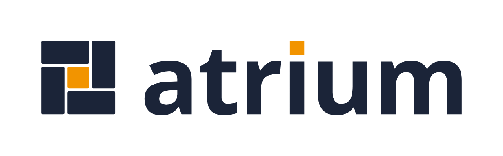 | 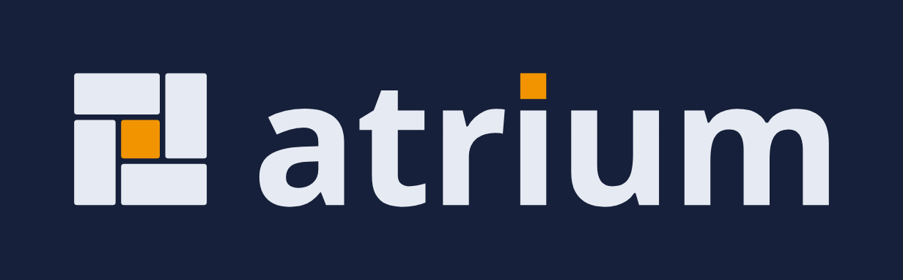 |

**Alternative "iSAQB atrium"** — only where the sender must be named, e.g. slides
for external audiences. The association's name sits as text above *atrium*,
without the iSAQB logo.

| | Light | Dark |
| --- | --- | --- |
| Grey | 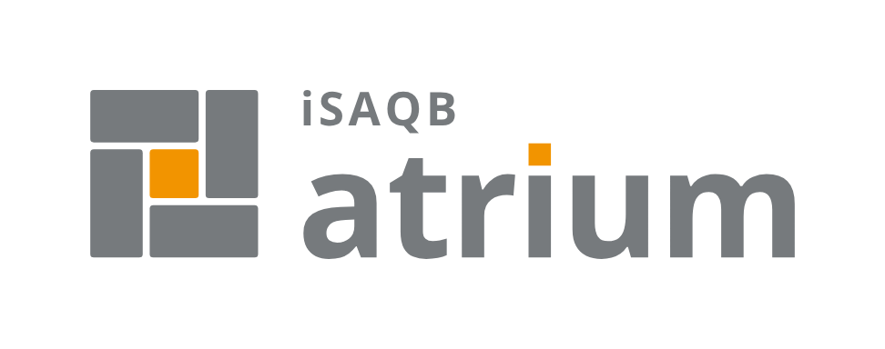 | 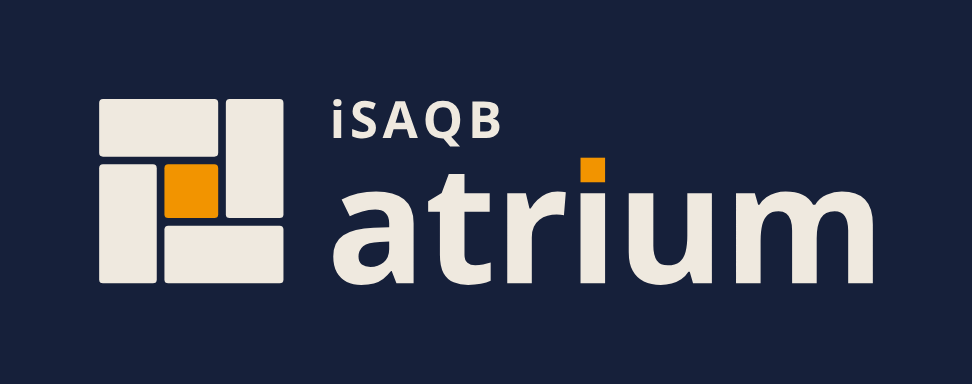 |
| Navy | 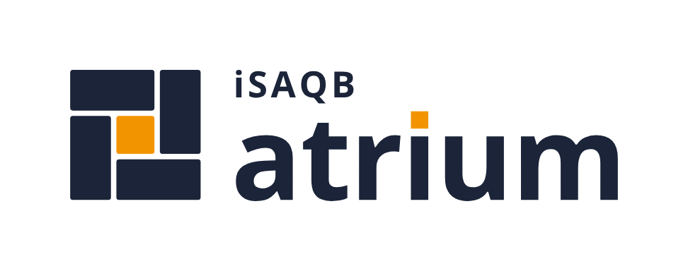 | 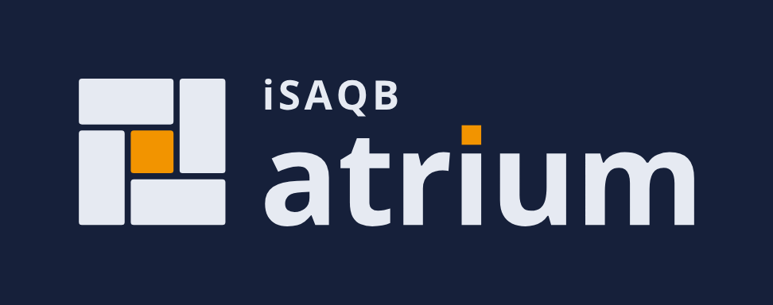 |

## Colours

| Role | Light | Dark (on `#16203a`) |
| --- | --- | --- |
| Grey, from "QB" in the iSAQB lettering | `#767a7d` | `#efe9df` |
| Navy, from the website | `#1b2438` | `#e6eaf2` |
| Courtyard and i-dot, iSAQB orange | `#f29400` | `#f29400` |
| Courtyard on orange ground | `#fdefd9` | |

Grey is the default for documents and slides; navy matches the website. The
website's orange (`#f29401`) is the same colour.

## Typeface

Wordmark and "iSAQB": Open Sans Bold (SIL Open Font License), tracking −0.01 em.
In the alternative lockup, "iSAQB" is set at 0.31 × wordmark size, tracking
0.09 em, flush with the "a". Text is outlined in all files, so no installed font
is needed. Where text is set live: fall back to Arial Bold.

## Rules

- Orange is only ever a surface (courtyard, i-dot), never text colour. "iSAQB"
  always takes the wordmark's colour.
- The iSAQB logo itself is not used; the association appears as text at most.
- Clear space: at least the courtyard's height on all sides.
- Below 120 px width, use the mark alone, without text. Smallest mark: 16 px.
- Do not rotate, recolour, add effects or outlines.

## Files

| Folder | Content | Use |
| --- | --- | --- |
| `svg/` | Vector files, transparent background | Masters for everything |
| `png/` | Transparent; mark 512 px, lockups 320 px high | Where SVG is not possible |
| `vorschau/` | PNG with background and margin | Previews in this guide |
| `tools/` | `make_brand.py` | Regenerates the SVGs from Open Sans |

Naming: `atrium-mark-…`, `atrium-lockup-…`, `atrium-isaqb-lockup-…`, each
`-grey` or `-navy`, suffix `-dark` for dark backgrounds. Plus `favicon.svg`
(navy, switches itself in dark mode), `atrium-mark-on-orange.svg`, and
`atrium-construction.svg` (the diagram above, added 2026-10-12; not part of the original brief).
PNGs rendered with Chrome.

## Use in this vault

The dashboard (`_system/apps/dashboard/static/`) uses the navy mark —
`atrium-mark-dark.svg` (= `atrium-mark-navy-dark.svg`) on the dark default theme,
`atrium-mark-light.svg` (= `atrium-mark-navy.svg`) on the light theme — plus
`favicon.svg` as `atrium-favicon.svg`. Mark only: the hero and top-bar slots are
narrower than 120 px, and the system name already appears as live text next to it.

This guide is also the dashboard's **About** page (`/about`): `about:` in
`_system/wiki.yaml` points at this file; the hero mark and the "About atrium"
link under the tagline lead there.
