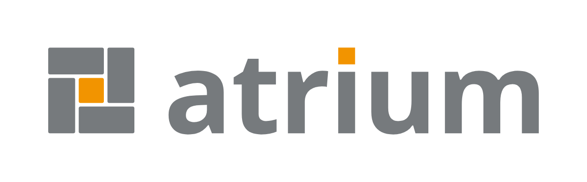
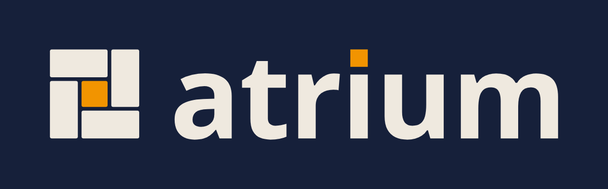
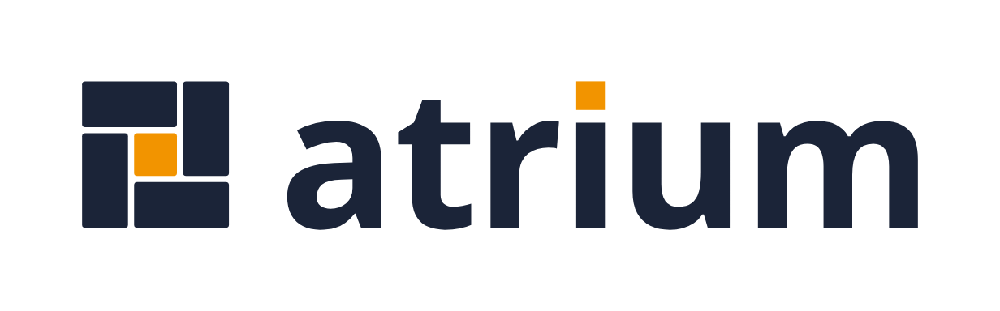
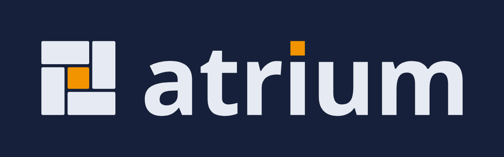
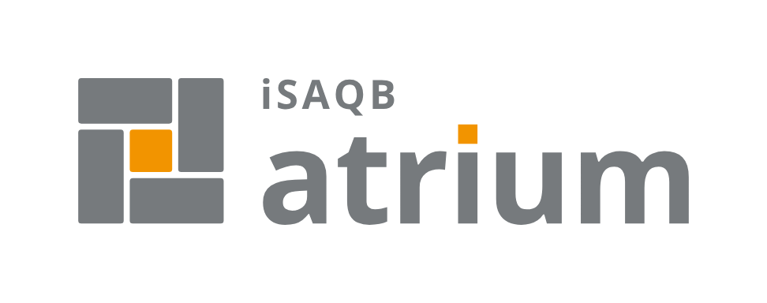
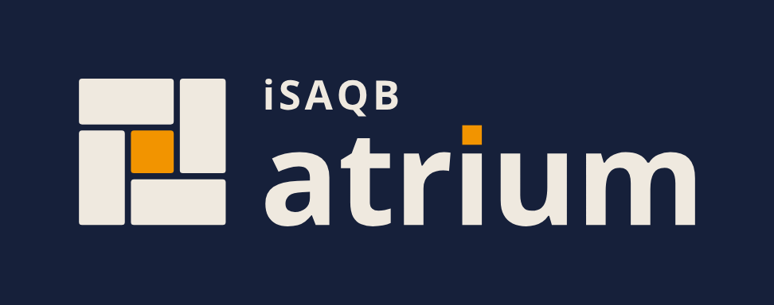
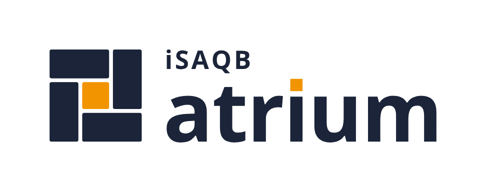
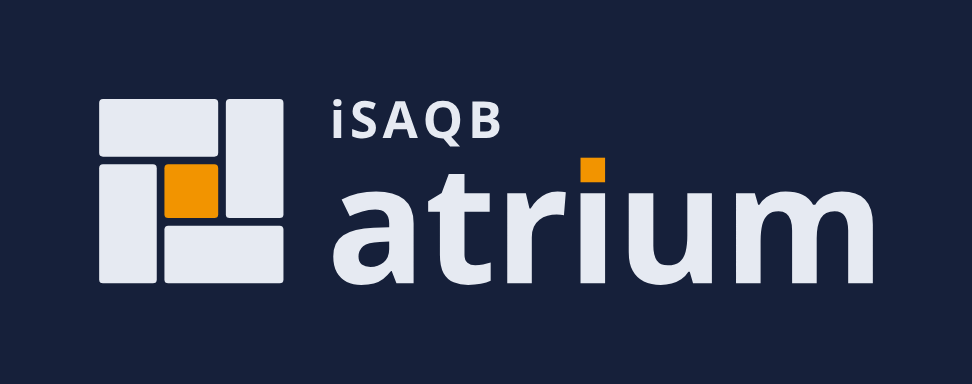

# atrium: Logo-Brief

Stand: 2026-10-12 · Projektname und Bildmarke für die iSAQB-Plattform (Website, Anbieter-App, Kontakt und Newsletter, Daten und Feeds).

## Idee

Ein Atrium ist der offene Hof im Zentrum eines Gebäudes, um den die Räume liegen. Die Bildmarke ist sein Grundriss von oben.

- **Der orange Hof in der Mitte ist der iSAQB**: Verein, Lehrpläne, Zertifizierung.
- **Die vier Räume sind die Zugänge**, über die man den iSAQB online erreicht.
- Die Räume drehen sich wie ein Windrad um den Hof. Kein Zugang ist der Haupteingang, und neue Räume lassen sich anbauen.

| Raum | Zugang | für wen |
| --- | --- | --- |
| 1, oben | Öffentliche Website | Interessierte, Mitglieder, Unternehmen |
| 2, rechts | Anbieter-App | Trainingsanbieter, mit Login und Review |
| 3, unten | Kontakt und Newsletter | Fragen und Neuigkeiten |
| 4, links | Datenrepository und Feeds | Maschinen: Termine, Anbieter, Module als JSON und ICS |

Die Wortmarke greift das auf: Der i-Punkt von „atrium“ ist ein oranges Quadrat, also der Hof und damit der iSAQB.

## Bildmarke

| Navy | Grau | Navy, dunkel | Grau, dunkel | auf Orange |
| --- | --- | --- | --- | --- |
|  |  |  |  |  |

### Konstruktion

Raster 48 × 48 Einheiten, drei Felder zu je 16. Jeder Raum ist um eine Einheit eingerückt, so entsteht überall dieselbe Fuge von 2 Einheiten. Eckradius 1.

| Element | x, y | Breite × Höhe |
| --- | --- | --- |
| Raum 1 (oben) | 0, 0 | 31 × 15 |
| Raum 2 (rechts) | 33, 0 | 15 × 31 |
| Raum 3 (unten) | 17, 33 | 31 × 15 |
| Raum 4 (links) | 0, 17 | 15 × 31 |
| Hof | 17, 17 | 14 × 14 |

## Lockups

Haupt-Lockup: Bildmarke und Wortmarke nebeneinander. Die Bildmarke reicht von der Grundlinie bis zur Oberkante des i-Punkts.

| | hell | dunkel |
| --- | --- | --- |
| Grau |  |  |
| Navy |  |  |

### Alternative: „iSAQB atrium“

Nur dort, wo der Absender genannt werden muss, etwa auf Folien für Externe. Der Vereinsname steht als Text über „atrium“, ohne das iSAQB-Logo.

| | hell | dunkel |
| --- | --- | --- |
| Grau |  |  |
| Navy |  |  |

## Farben

| Rolle | hell | dunkel (auf `#16203a`) |
| --- | --- | --- |
| Grau, aus „QB“ im iSAQB-Schriftzug | `#767a7d` | `#efe9df` |
| Navy, aus der Website | `#1b2438` | `#e6eaf2` |
| Hof und i-Punkt, iSAQB-Orange | `#f29400` | `#f29400` |
| Hof auf oranger Fläche | `#fdefd9` | |

Grau ist der Standard für Dokumente und Folien, Navy passt zur Website. Das Orange der Website (`#f29401`) ist dieselbe Farbe.

## Schrift

Wortmarke und „iSAQB“: Open Sans Bold (SIL Open Font License), Laufweite −0,01 em. In der Alternative steht „iSAQB“ in 0,31 × Wortmarkengröße mit Laufweite 0,09 em, bündig mit dem „a“. In den Dateien ist die Schrift in Pfade umgewandelt, sie hängt also von keiner installierten Schrift ab. Wo Text live gesetzt wird: Rückfall Arial Bold.

## Regeln

- Orange ist nur Fläche (Hof, i-Punkt), nie Schrift. „iSAQB“ steht immer in der Farbe der Wortmarke.
- Das iSAQB-Logo selbst wird nicht verwendet, der Verein erscheint höchstens als Text.
- Schutzzone: rundum mindestens die Höhe des Hofs frei.
- Unter 120 px Breite nur die Bildmarke, ohne Text. Kleinste Bildmarke: 16 px.
- Nicht drehen, nicht umfärben, keine Effekte, keine Konturen.

## Dateien

| Ordner | Inhalt | wofür |
| --- | --- | --- |
| [`svg/`](svg/) | Vektordateien, transparenter Hintergrund | Originale für alles |
| [`png/`](png/) | transparent, Bildmarke 512 px, Lockups 320 px hoch | wo kein SVG geht |
| [`vorschau/`](vorschau/) | PNG mit Hintergrund und Rand | Ansicht in diesem Brief |

Namensschema: `atrium-mark-…`, `atrium-lockup-…`, `atrium-isaqb-lockup-…`, jeweils `-grey` oder `-navy`, Zusatz `-dark` für dunkle Hintergründe. Dazu `favicon.svg` (Navy, schaltet im Dunkelmodus selbst um) und `atrium-mark-on-orange.svg`.

Erzeugt mit `tools/make_brand.py` aus Open Sans; die PNGs sind mit Chrome gerendert.
