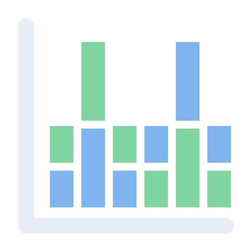
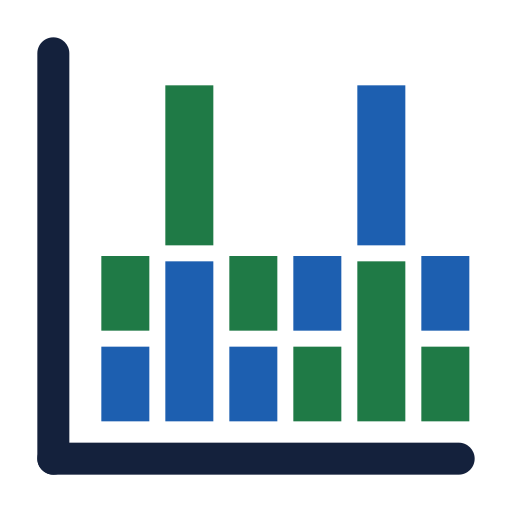
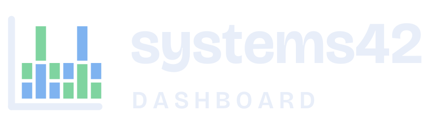

# Systems42 Dashboard: the helix

**The idea:** Requirements (the green req42 strand) and Architecture (the blue
arc42 strand) wound into one helix. It is the systems42 logo. The drawing
comes unchanged from the Systems42 meta repository (`brand/`,
[meta#73](https://github.com/systems42-org/meta/pull/73)).

| Part | Dark | Light |
|------|------|-------|
| Requirements strand, "42" | `#199c7e` | `#0f7f66` |
| Architecture strand | `#3a86e6` | `#1667c4` |
| Wordmark | `#e8eef9` | `#14213c` |

No theme token holds the strand colours, so the intro declares them once per
theme as `--brand-req` and `--brand-arc`.

**Favicon:** a shorter helix with fewer turns, so it still reads at 16 px.

**Rules:** no text in the mark, transparent background. Do not recolour,
stretch or rotate it.

**Intro:** the helix winds itself up, "systems42" rises in letter by letter,
then "dashboard" below it. It takes about 2.4 s and runs once per tab.
Reduced motion skips it, and any click or key ends it.

**Lockup:** for use outside the dashboard (website, README, slides), the helix
with "systems42" over "dashboard" in Bricolage Grotesque 700, text as
outlines. The dashboard itself never shows it. Its header writes
`system_name` from `_system/wiki.yaml`.

**Files:** the dashboard's shipped brand `systems42`,
`_system/apps/dashboard/brands/systems42/`, holds `mark-dark.svg`,
`mark-light.svg`, `favicon.svg` and the intro, `intro.html`. This folder holds
the PNGs (`mark-dark.png`, `mark-light.png`, `favicon.png`) and the lockups
(`lockup-dark.svg`, `lockup-light.svg` and their PNGs).

**Earlier marks:** the Chart mark, shipped until 2026-11-26, is kept as a
complete brand folder in [archive/](archive/README.md).
