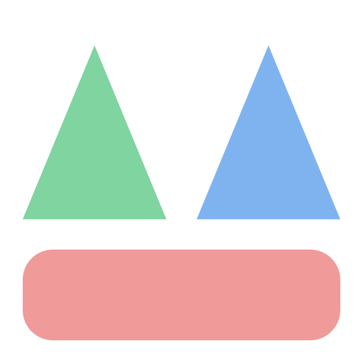

# Systems42 Dashboard: the mark

**The idea:** the home page as a picture. Requirements and Architecture are two
peaks, Commons is the ground they stand on, and the valley between is where the
status and open issues sit.

**Grid:** 48 × 48, margin 3, gap 4, ground radius 4.

| Part | Token | Dark | Light | Shape |
|------|-------|------|-------|-------|
| Requirements peak | `--area-req` | `#7fd4a0` | `#1f7a46` | triangle (3,29) (12.5,6) (22,29) |
| Architecture peak | `--area-arc` | `#7fb3f0` | `#1d5fb0` | triangle (26,29) (35.5,6) (45,29) |
| Commons ground | `--area-org` | `#f09a9a` | `#b03a3a` | rect x3 y33, 42 × 12, radius 4 |

**Rules:** smallest size 16 px; keep about 5 units of clear space; no text,
outlines, gradients or shadows; do not recolour, reorder, stretch or rotate.

**Intro:** the ground grows, then the two peaks rise, then a fade; about 2 s,
once per tab, skipped under reduced motion, any click or key ends it.

**Files:** `static/brand/` holds `mark-dark.svg`, `mark-light.svg` and
`favicon.svg`; `templates/_brand_intro.html` holds the intro; this folder holds
the PNGs (`mark-dark.png`, `mark-light.png`, `favicon.png`).
