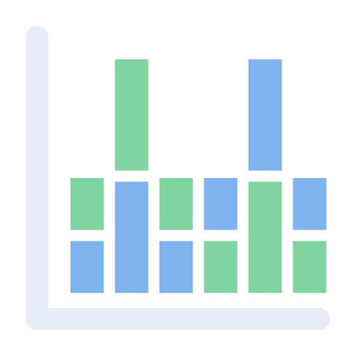
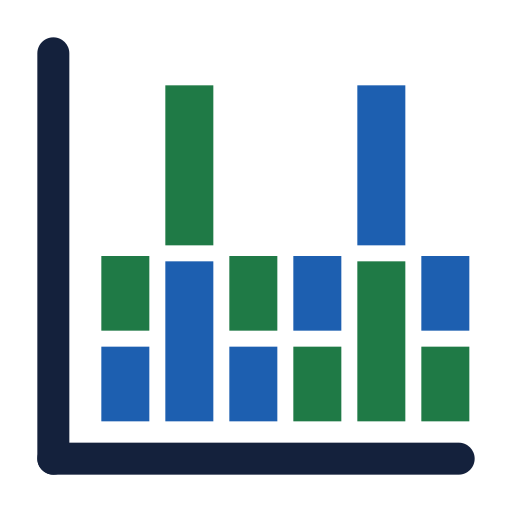
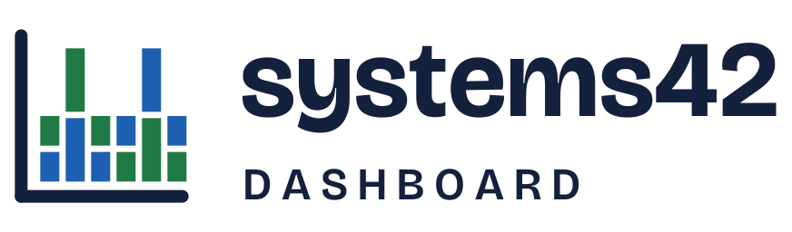

# Systems42 Dashboard: the Chart mark

**The idea:** the dashboard as a chart. Requirements (green) and Architecture
(blue) are filled in side by side, column by column, on one axis.

**Grid:** 48 × 48. Axis 3 wide with round ends, vertical x 3.5 y 3.5 to 44.5,
base y 41.5 x 3.5 to 44.5. Six columns 4.5 wide with a gap of 1.5, starting at
x 9.5, standing on y 39.5. Each column is two blocks split by a gap of 1.5.

| Part | Token | Dark | Light |
|------|-------|------|-------|
| Axis | `--ink` | `#e8eef9` | `#14213c` |
| Requirements blocks | `--area-req` | `#7fd4a0` | `#1f7a46` |
| Architecture blocks | `--area-arc` | `#7fb3f0` | `#1d5fb0` |

| Column | 1 | 2 | 3 | 4 | 5 | 6 |
|--------|---|---|---|---|---|---|
| Height | short | tall | short | short | tall | short |
| Lower block | arc | arc | arc | req | req | req |
| Upper block | req | req | req | arc | arc | arc |

Short columns are two blocks of 7, tall columns two blocks of 15.

**Favicon:** below 32 px the mark is reduced to the axis and three solid
columns (green, blue, green) without the split, on a 3-unit grid so every edge
falls on a pixel at 16 px. The axis follows the tab bar's colour scheme.

**Rules:** smallest size 32 px for the full mark, 16 px for the favicon; keep
about 5 units of clear space; no text, outlines, gradients or shadows; the
background stays transparent; do not recolour, reorder, stretch or rotate.

**Intro:** the axis draws itself (up, then along the base), then the columns
grow from left to right, each lower block before its upper one, then a fade;
about 2 s, once per tab, skipped under reduced motion, any click or key ends it.

**Lockup:** for use outside the dashboard (website, README, slides), the mark
with "systems42" over "DASHBOARD" in Bricolage Grotesque, text as outlines. The
dashboard itself never shows it; its header writes `system_name` from
`_system/wiki.yaml`.

**Files:** this folder holds the brand itself (`mark-dark.svg`,
`mark-light.svg`, `favicon.svg` and the intro, `intro.html`), the PNGs (`mark-dark.png`, `mark-light.png`, `favicon.png`) and the lockups
(`lockup-dark.svg`, `lockup-light.svg` and their PNGs).
